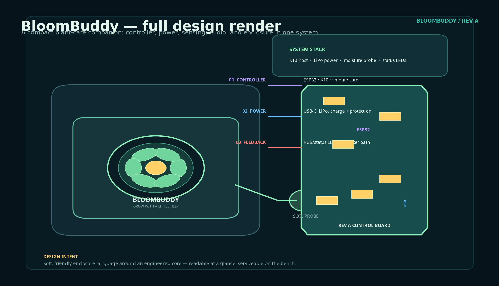
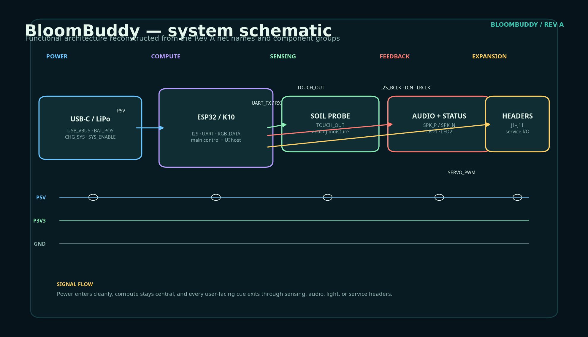

# BloomBuddy

BloomBuddy is a compact plant-care companion built around the K10/ESP32 host, a routed Rev A control board, LiPo power, status feedback, audio, and an analog soil-moisture probe.

## Design render set

The source renderer is [`render_bloombuddy_design.py`](render_bloombuddy_design.py); rerun it after updating the board source to regenerate the image set.
