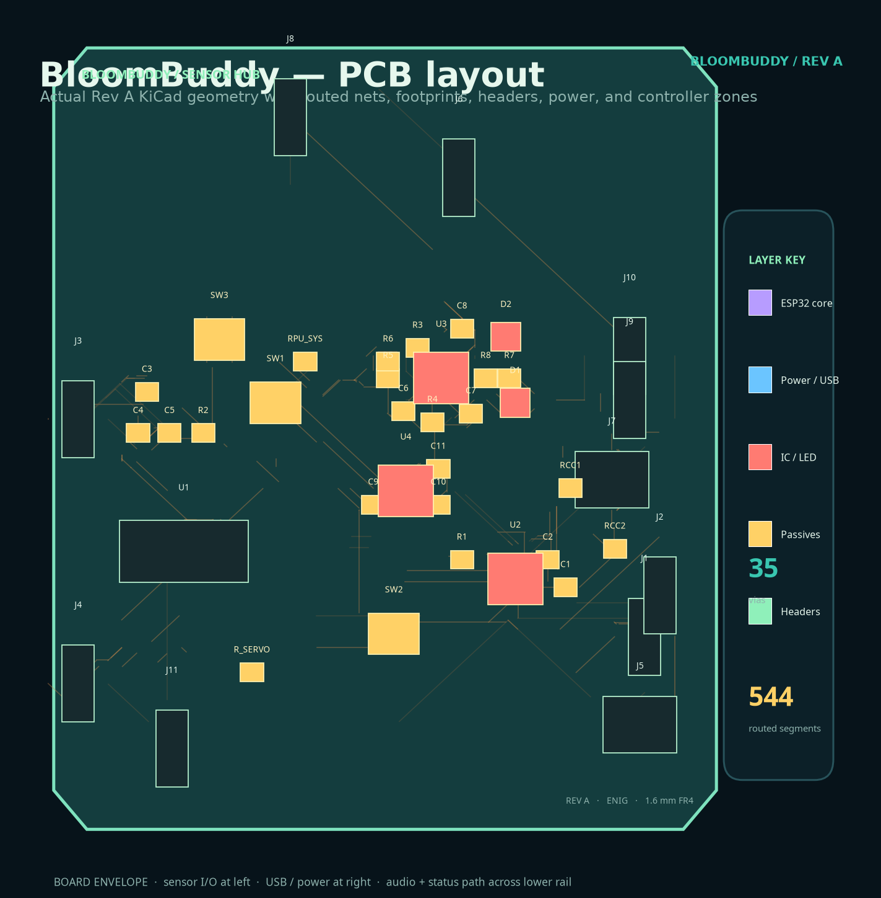
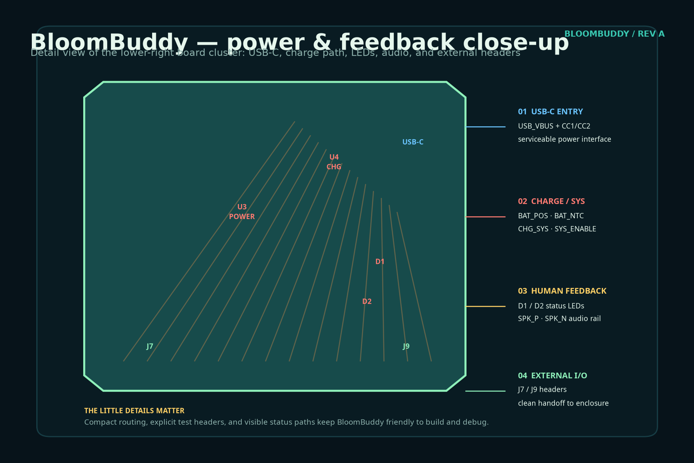
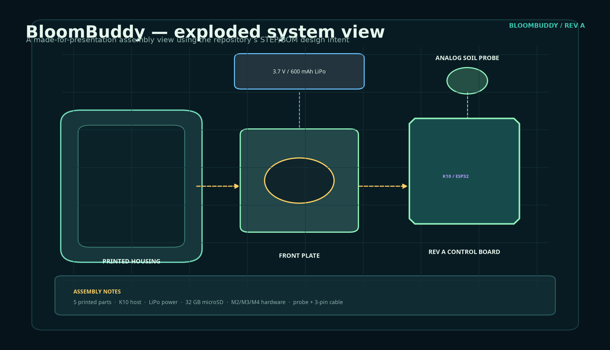

# BloomBuddy

BloomBuddy is a compact plant-care companion built around the K10/ESP32 host, a routed Rev A control board, LiPo power, status feedback, audio, and an analog soil-moisture probe.

## Design render set

The following presentation renders were created from the repository’s KiCad PCB, schematic, BOM, and assembly intent:

1. **Full assembly render** — enclosure, control board, sensor probe, and system callouts.
2. **PCB layout render** — routed Rev A board with component zones and layer key.
3. **Schematic architecture render** — power, compute, sensing, feedback, and expansion flow.
4. **Power and feedback close-up** — USB-C, charging, status LEDs, audio, and service headers.
5. **Exploded system view** — housing, front plate, battery, probe, and control board assembly.

The source renderer is [`render_bloombuddy_design.py`](render_bloombuddy_design.py); rerun it after updating the board source to regenerate the image set.
